<p align="center">
  
</p>

<h1 align="center">Vacayo</h1>

<p align="center">
  <b>Ton carnet de voyage, à plusieurs, avec un assistant IA.</b><br>
  Hôtels, restos, activités et planning jour par jour, tout au même endroit.
</p>

<p align="center">
  <a href="https://vacayo-vert.vercel.app"><b>Ouvrir Vacayo →</b></a>
</p>

<p align="center">
  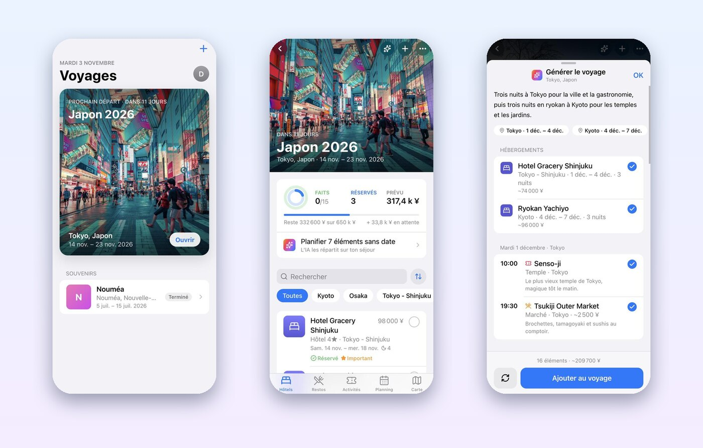
</p>

---

**Sommaire** · [En deux mots](#en-deux-mots) · [Premiers pas](#premiers-pas) ·
[Organiser un voyage](#organiser-un-voyage) · [L’assistant IA](#lassistant-ia) ·
[Ton compte](#ton-compte) · [Questions fréquentes](#questions-fréquentes) ·
[Pour les développeurs](#pour-les-développeurs)

## En deux mots

Préparer un voyage, c’est souvent des captures d’écran, des mails de réservation
éparpillés et une note partagée que personne ne retrouve. Vacayo range tout au même
endroit :

- 🏨 **les hôtels**, avec les dates d’arrivée et de départ ;
- 🍜 **les restos** et 🎟️ **les activités**, avec prix, horaires et notes ;
- 📅 **un planning** qui montre chaque journée heure par heure ;
- 💶 **le budget** : ce qui est prévu, réservé, déjà fait ;
- ✨ **un assistant IA** qui peut préparer tout le voyage à partir de la destination
  et des dates, lire un mail de réservation, proposer des idées et répondre à tes
  questions.

Vacayo est une application web : elle s’ouvre dans le navigateur, sans passer par
l’App Store, et s’installe sur l’écran d’accueil de l’iPhone comme une vraie app.

## Premiers pas

1. Sur ton iPhone, ouvre **[vacayo-vert.vercel.app](https://vacayo-vert.vercel.app)**
   dans Safari.
2. Touche **Créer un compte** (un e-mail et un mot de passe suffisent).
3. Un court **tutoriel** te présente l’app en quelques pages : balaie vers la gauche
   ou touche **Continuer**. Tu peux le passer, et le revoir plus tard depuis ton compte.
4. Pour l’installer : dans Safari, touche **Partager** puis **Sur l’écran d’accueil**.
   Vacayo s’ouvre alors en plein écran, avec son icône.

<p align="center">
  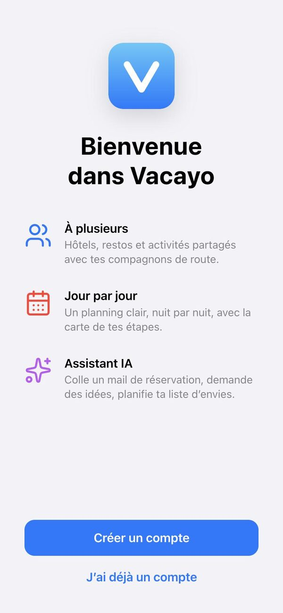
  &nbsp;
  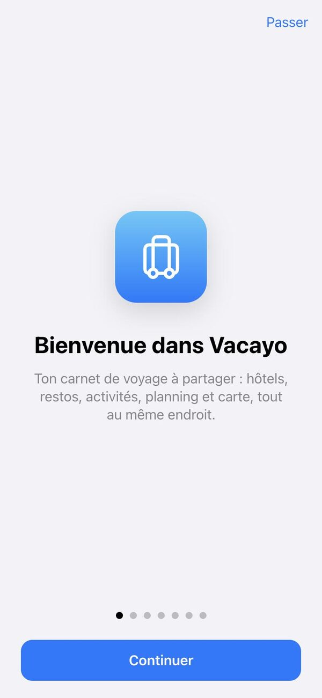
  &nbsp;
  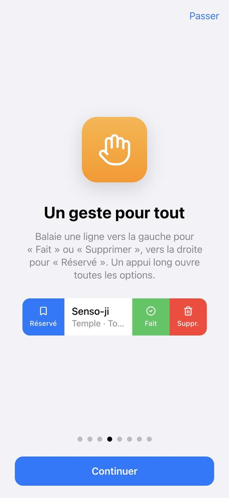
</p>

## Organiser un voyage

### Tous tes voyages

L’écran d’accueil met en avant le **prochain départ**, avec le compte à rebours.
Les voyages passés sont rangés dans **Souvenirs**. Pour en créer un, touche **+** en
haut à droite : destination, date d’arrivée, date de départ, et c’est tout.

<p align="center">
  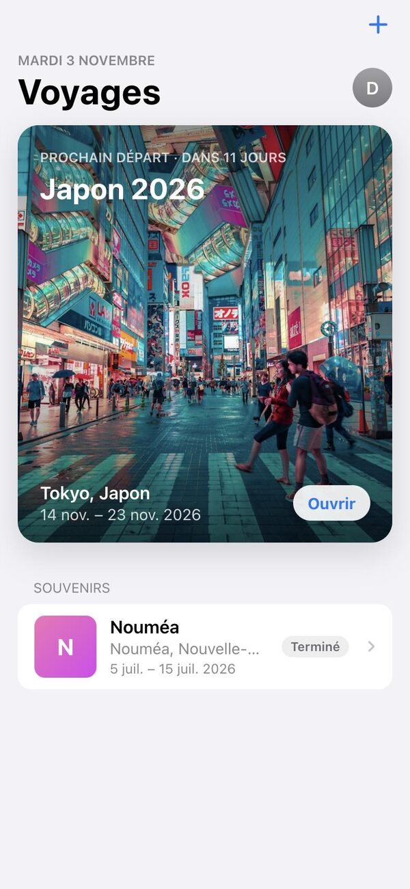
</p>

### Un voyage, d’un coup d’œil

En haut d’un voyage, un résumé : combien d’éléments sont **faits**, combien sont
**réservés**, et le **budget prévu** comparé au budget total. En dessous, cinq
onglets : Hôtels, Restos, Activités et Planning. On peut chercher, trier et
filtrer par ville.

<p align="center">
  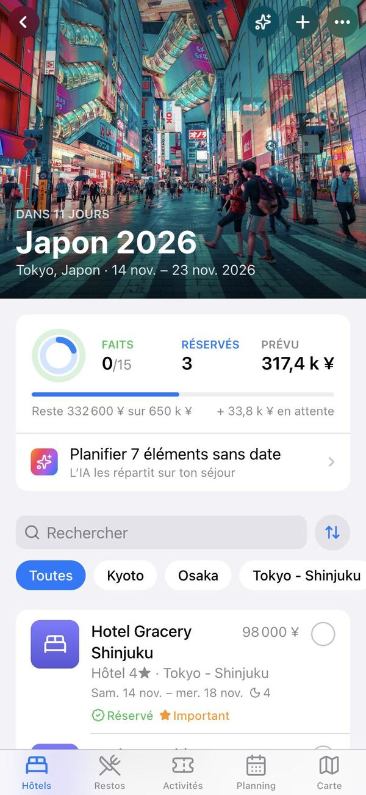
  &nbsp;
  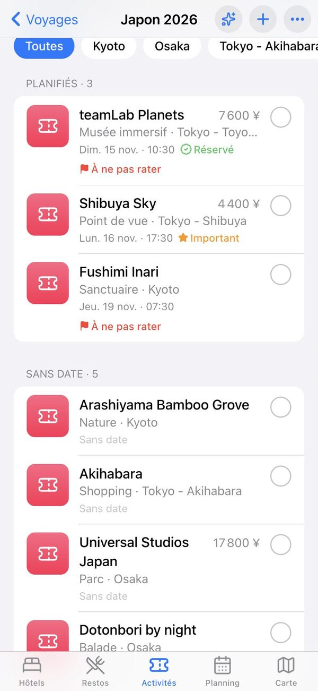
</p>

### Un geste pour tout

Comme dans Mail sur iPhone :

- balaie une ligne **vers la gauche** pour la marquer **Faite** ou la **Supprimer** ;
- balaie **vers la droite** pour la marquer **Réservée**, ou **Plus tard** pour la retirer
  du planning sans la perdre : elle retourne dans ta liste d’envies (**Annuler** en bas
  de l’écran si tu t’es trompé) ;
- touche le **rond** à droite pour cocher ;
- un **appui long** ouvre toutes les options.

<p align="center">
  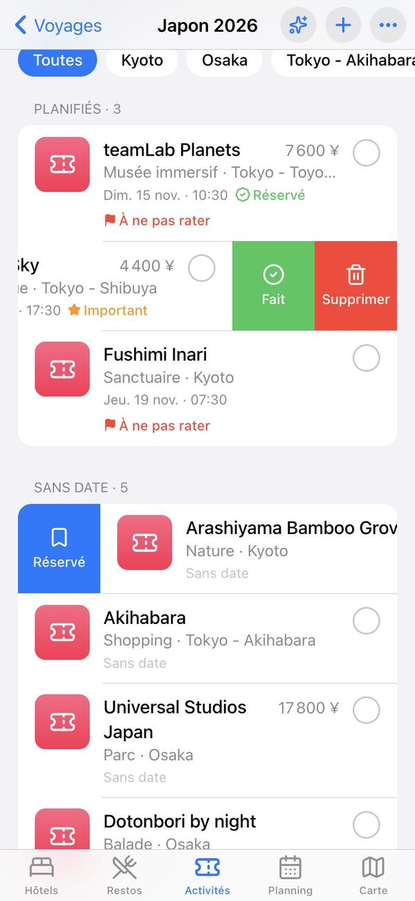
</p>

### La fiche d’un lieu

Touche un élément pour voir sa fiche : dates, prix, priorité, notes, numéro de
réservation, liens (Booking, Google Maps…). Les boutons du haut changent son statut,
le modifient ou le dupliquent. **Conseils de l’IA sur ce lieu** demande à l’assistant
quoi savoir avant d’y aller.

<p align="center">
  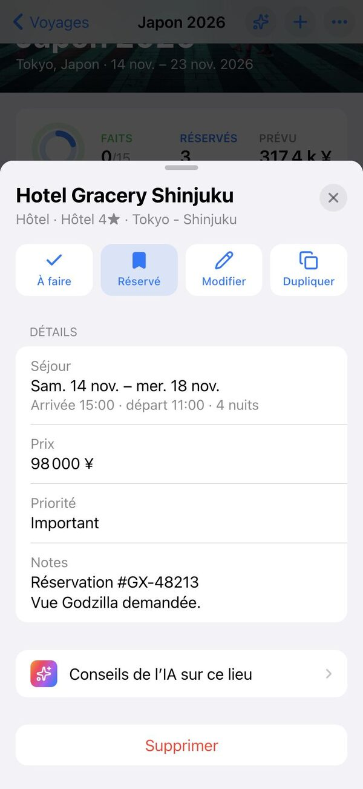
</p>

### Le planning jour par jour

L’onglet **Planning** affiche la semaine en haut, puis la journée choisie heure par
heure : l’hôtel où l’on dort, puis le matin, l’après-midi et le soir.
**Optimiser la journée** demande à l’IA un ordre de visite plus logique.

<p align="center">
  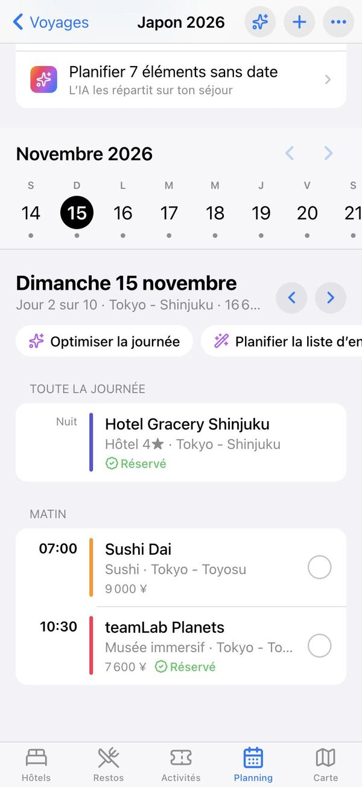
</p>

## L’assistant IA

L’assistant s’appuie sur **Claude Haiku**, un modèle d’intelligence artificielle
conçu par Anthropic. Il est reconnaissable à son dégradé de couleurs ✨.

> **Rien n’est ajouté sans ton accord.** L’IA propose, tu décoches ce qui ne te plaît
> pas, puis tu valides. Elle peut se tromper (un horaire, un prix) : vérifie avant de
> réserver.

Le tutoriel consacre une page à chacune des deux fonctions principales (générer le
voyage, le copilote), et une dernière page résume les autres :

<p align="center">
  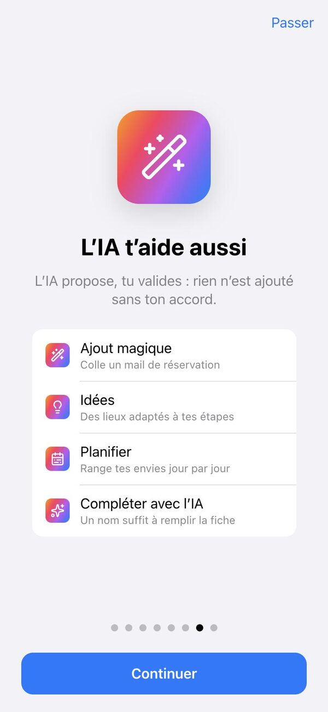
</p>

### Générer tout le voyage

À la création d’un voyage, laisse **Préparer avec l’IA** activé. Choisis le rythme
(tranquille, équilibré, intense), tes envies (culture, gastronomie, nature…), ton
niveau d’hébergement, et ajoute une précision si tu veux (« arrivée le matin »,
« on adore les izakayas »).

L’IA propose alors les **étapes** du voyage, les **hôtels** de chaque étape et un
**programme jour par jour**, en tenant compte du jour d’arrivée et du jour de départ.
Pendant la préparation (environ une demi-minute pour une semaine), tu suis
l’avancement étape par étape : villes choisies, hôtels, puis chaque jour du programme.
Tu peux ensuite tout revoir, relancer une autre proposition, puis **Ajouter au voyage**.

<p align="center">
  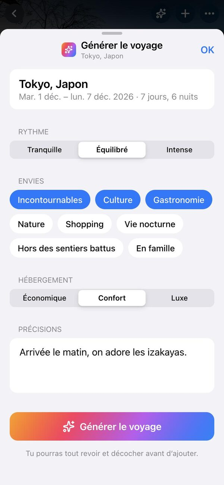
  &nbsp;
  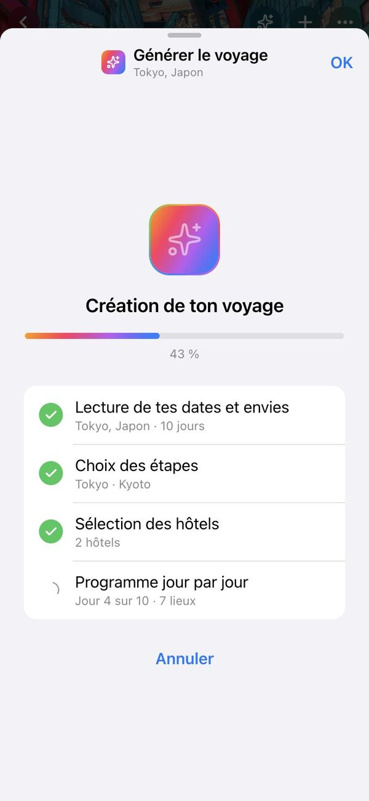
  &nbsp;
  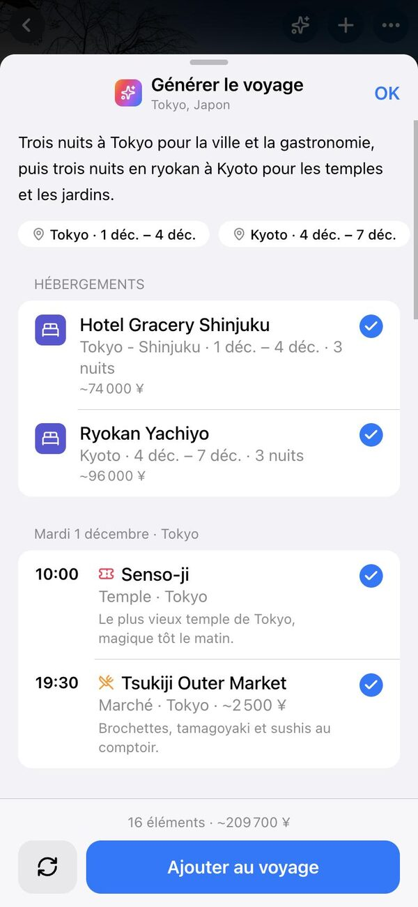
</p>

### Ajout magique

Colle un **mail de confirmation**, une liste de restos envoyée par un ami ou un
article de blog : l’IA repère les lieux, les dates, les prix et les numéros de
réservation, et prépare les fiches. Bouton **+** d’un voyage → **Ajout magique**.

<p align="center">
  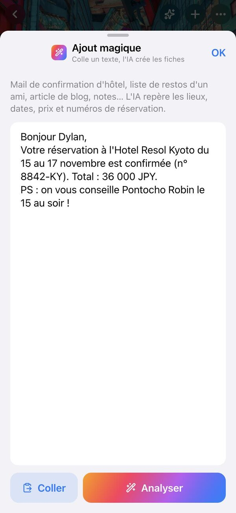
  &nbsp;
  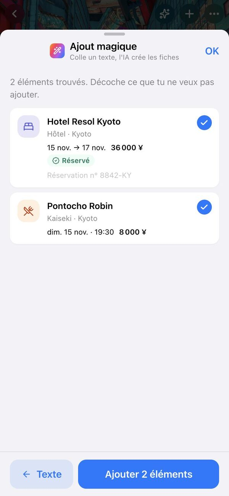
</p>

### Des idées

En panne d’inspiration ? Bouton **+** → **Idées** : l’IA propose des hôtels, des
restos ou des activités dans les villes de ton voyage, avec un conseil pour chacun.
Touche **+** pour l’ajouter à ta liste d’envies.

### Planifier la liste d’envies

Les éléments sans date forment ta **liste d’envies**. La date n’est jamais obligatoire :
dans la fiche d’un resto ou d’une activité, l’interrupteur **Planifier** la retire ou
l’ajoute. Touche **Planifier** dans le résumé du voyage : l’IA place chaque idée un
jour où tu dors dans la même ville, sans surcharger les journées.

<p align="center">
  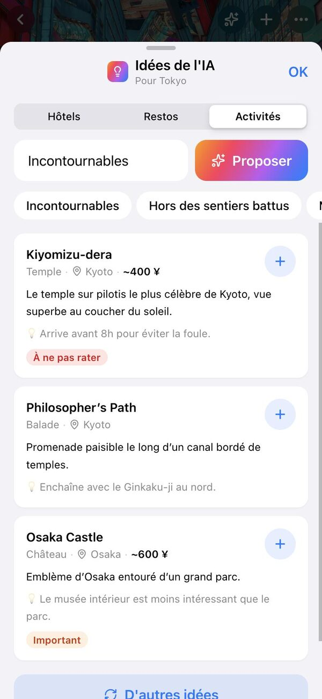
  &nbsp;
  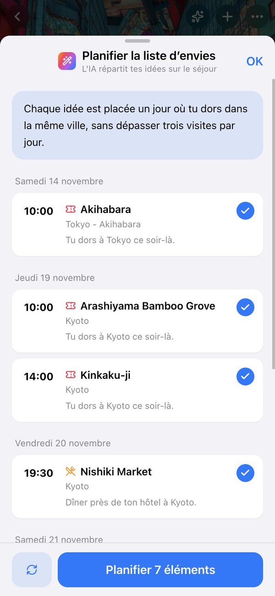
</p>

### Compléter une fiche

En ajoutant un lieu à la main, tape juste son nom puis **Compléter avec l’IA** : la
ville, la catégorie, un prix estimé, la priorité et des conseils sont remplis pour
toi. Seuls les champs vides sont complétés.

### Le copilote

Le bouton ✨ en haut d’un voyage ouvre le **copilote**, un chat qui connaît tout ton
voyage : « Qu’est-ce qu’il me reste à réserver ? », « Où dîner près de l’hôtel
mardi ? », « Que faire s’il pleut à Kyoto ? ».

<p align="center">
  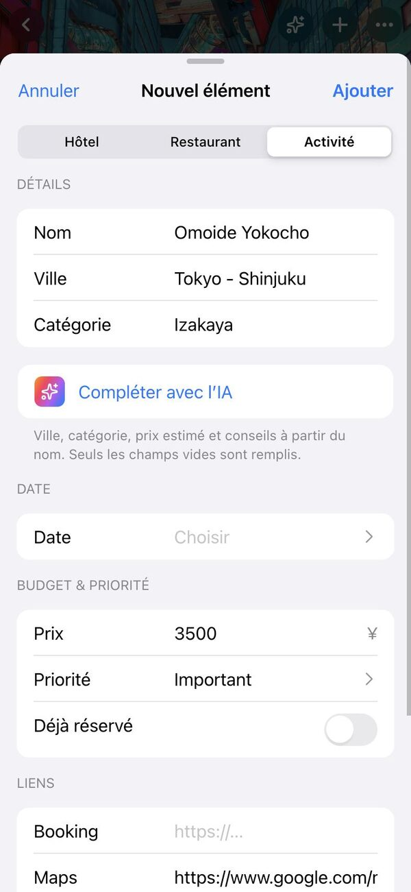
  &nbsp;
  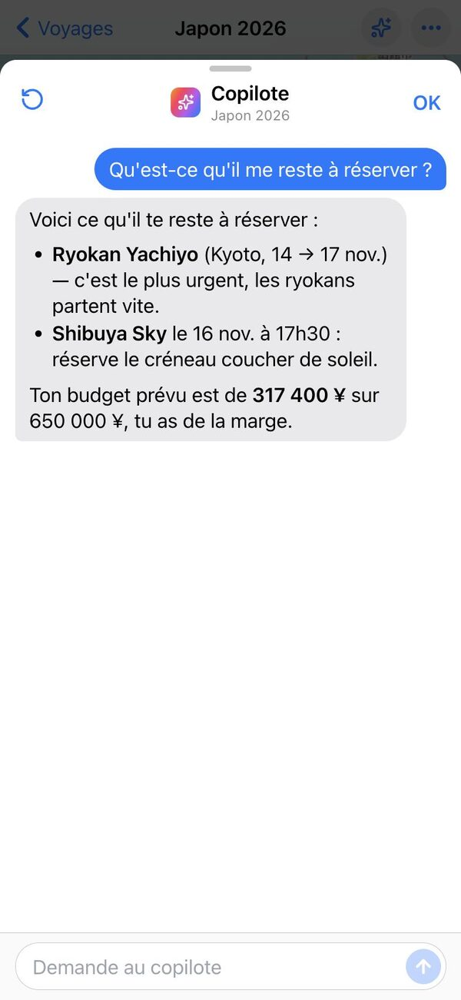
</p>

## Ton compte

Touche ton initiale en haut de la liste des voyages :

- **Assistant IA** : son état (activé, ou ta clé personnelle si besoin) ;
- **Revoir le tutoriel** ;
- **Importer un voyage** à partir d’un fichier exporté depuis Vacayo ;
- **Se déconnecter**.

<p align="center">
  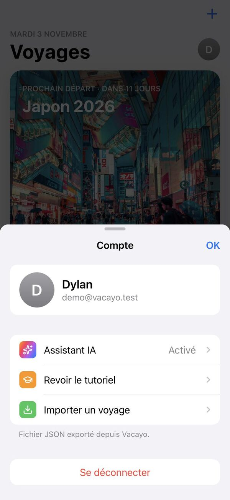
</p>

## Questions fréquentes

**Est-ce que ça marche sur Android ou sur ordinateur ?**
Oui : Vacayo s’ouvre dans n’importe quel navigateur récent. Il est simplement pensé
d’abord pour l’iPhone.

**Comment partager un voyage ?**
Un voyage peut réunir plusieurs membres, en modification ou en lecture seule. Il n’y a
pas encore d’écran d’invitation dans l’app. En attendant, le menu **···** d’un voyage
→ **Exporter** crée un fichier que tu peux envoyer ; l’autre personne l’ouvre depuis
**Compte → Importer un voyage** (elle obtient sa propre copie).

**Où sont mes données ?**
Dans Firebase, le service en ligne de Google sur lequel Vacayo est construit. Seuls
les membres d’un voyage le voient.

**Qu’est-ce qui est envoyé à l’IA ?**
Uniquement quand tu utilises une fonction ✨ : le contenu du voyage utile à la demande
(destination, dates, éléments, ou le texte que tu as collé). Il passe par le serveur
de Vacayo, qui garde la clé d’accès à l’IA et vérifie que tu es connecté.

**J’ai passé le tutoriel trop vite.**
**Compte → Revoir le tutoriel.**

---

## Pour les développeurs

Vue 3 + Vite + Vant 4 + Tailwind, Pinia, vue-router.
Données dans Firebase (Auth + Firestore). IA via le SDK `@anthropic-ai/sdk`.
Déployé sur Vercel.

### Démarrer

```bash
npm install
npm run dev            # contre le Firebase de prod
```

#### En local, sans toucher la prod (émulateurs Firebase)

Il faut Java (pour l’émulateur Firestore) et `firebase-tools`.

```bash
npm run emulators       # terminal 1 : Auth + Firestore locaux (UI sur :4000)
npm run seed:emulators  # une fois : compte démo + voyage « Japon 2026 »
npm run dev:emulators   # terminal 2 : l’app branchée sur les émulateurs
```

Compte démo : voir l’en-tête de `scripts/seed-emulators.js` (n’existe que dans l’émulateur).

### Sur iPhone

L’interface suit les codes d’iOS (typo système, grands titres, listes groupées,
balayages, feuilles et alertes natives), en mode clair uniquement. Jetons de design
`--vc-*` dans `src/style.css`, partagés avec Vant (`--van-*`). Les feuilles plein
écran font `--vc-sheet-h` de haut : elles s’arrêtent sous la barre d’état et la
Dynamic Island. Barre d’état opaque (`apple-mobile-web-app-status-bar-style` à
`default`) : en `black-translucent`, iOS 26 floute le haut de l’app installée sur
l’écran d’accueil, boutons de navigation compris. Icône dans `public/apple-touch-icon.png`, manifeste dans `public/manifest.webmanifest`.

### Tutoriel de première utilisation

Champ `users/{uid}.tutorialDone` (booléen) :

- `false` : le tutoriel (`src/components/TutorialSheet.vue`) s’affiche à l’ouverture ;
- il passe à `true` quand l’utilisateur le termine ou touche « Passer » ;
- un compte créé avant ce champ reçoit `false` à sa prochaine connexion
  (`ensureUserDoc` dans `src/stores/auth.js`) ;
- « Revoir le tutoriel » (Compte) le rouvre sans toucher au champ.

Remettre **tout le monde** à `false` :

1. Console Firebase → Paramètres du projet → Comptes de service → **Générer une
   nouvelle clé privée**, enregistrée sous `.firebase-admin-key.json` à la racine
   (ignoré par git, ne jamais le commiter).
2. Lancer :
   ```bash
   npm run reset:tutorial
   ```

Sur les émulateurs : `FIRESTORE_EMULATOR_HOST=127.0.0.1:8080 npm run reset:tutorial`.

### Assistant IA (Claude Haiku)

Toutes les fonctions passent par `src/services/ai.js` (modèle `claude-haiku-5-5`,
SDK chargé à la demande) :

| Fonction | Où | Ce qu’elle fait |
|---|---|---|
| Générer le voyage | création d’un voyage (« Préparer avec l’IA ») | Étapes, hôtels et programme jour par jour selon les dates d’arrivée et de départ |
| Copilote | ✨ en haut d’un voyage, « Conseils de l’IA » sur une fiche, « Optimiser la journée » au planning | Chat en streaming qui connaît tout le voyage |
| Ajout magique | bouton + → Ajout magique | Mail de réservation / liste collée → fiches pré-remplies à valider |
| Idées | bouton + → Idées, ou liste vide | Suggestions de lieux selon les villes étapes, ajoutées à la liste d’envies |
| Planifier la liste d’envies | résumé du voyage, onglet Planning | Répartit les éléments sans date sur les jours (selon la ville où l’on dort), à valider |
| Compléter avec l’IA | formulaire d’ajout | Remplit ville, catégorie, prix estimé, priorité et conseils à partir du nom |

Rien n’est écrit sans validation de l’utilisateur, sauf la complétion du formulaire
(qui ne remplit que les champs vides, avant enregistrement).

Trois façons de fournir la clé Anthropic :

1. **Proxy (prod)** : `ai-proxy/` déployé sur Vercel (voir son README), et la
   variable d’environnement Vercel `VITE_AI_PROXY_URL` du projet de l’app. La clé reste
   sur le proxy, qui n’accepte que les utilisateurs Firebase connectés.
2. **Clé perso** : sans proxy, chaque utilisateur colle sa clé dans
   Compte → Assistant IA. Elle reste dans le `localStorage` de son appareil.
3. **Dev local** : dans `.env.local` (ignoré par git)
   ```
   ANTHROPIC_API_KEY=sk-ant-...
   VITE_AI_PROXY_URL=/anthropic
   ```
   Le serveur Vite ajoute la clé côté serveur (`vite.config.js`), elle n’atteint jamais le navigateur.

### Déploiement

Projet Vercel `vacayo` relié à ce dépôt : chaque push sur `main` part en production
(<https://vacayo-vert.vercel.app>), chaque branche / PR obtient une URL d’aperçu.
Config dans `vercel.json` (build Vite, toutes les routes renvoient `index.html` pour le
routeur, cache long sur `assets/`) ; `.vercelignore` écarte le proxy, les scripts et
`docs/`. Variable de build : `VITE_AI_PROXY_URL`.

### Membres d’un voyage

`trips/{id}.members` associe chaque `uid` à un rôle : `owner`, `editor` ou `viewer`.
Pas encore d’écran d’invitation : un membre s’ajoute pour l’instant directement dans
Firestore.

### Captures du README

Dans `docs/screenshots/`, prises sur les émulateurs (compte démo) dans une fenêtre de
393 × 852 (iPhone 15), réduites à 600 px de large.

### Structure

- `src/views/` : connexion, liste des voyages, détail d’un voyage
- `src/components/` : cartes, fiches (bottom sheets), onglets (`tabs/`), IA (`ai/`), tutoriel
- `src/stores/` : Pinia (auth, voyages, éléments, IA)
- `src/style.css` : jetons de design
- `scripts/` : seed des émulateurs, remise à zéro du tutoriel
- `ai-proxy/` : Vercel Function qui garde la clé Anthropic
- `docs/screenshots/` : captures du README
